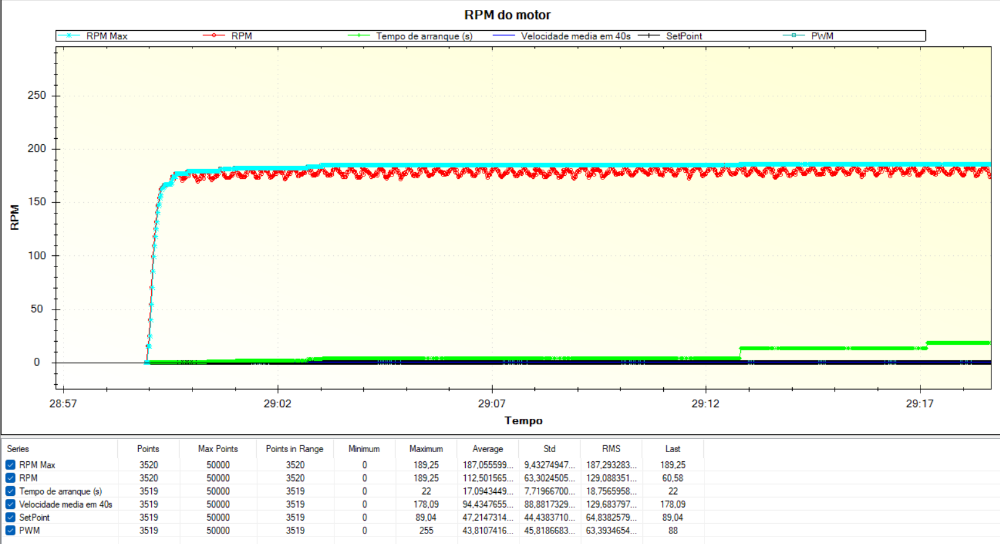

# DC Motor PID Speed Control (Arduino)

Closed-loop speed control of a DC motor on an **Arduino**, with the **PID algorithm written from scratch** (no PID library). The motor speed is measured in real time with an optical sensor reading a toothed wheel, and the controller adjusts the PWM signal to follow a target speed.

The project covers the whole tuning process: automatic calibration of the motor's maximum speed, a study of the **P**, **PI** and **PID** controllers at three speed levels (25%, 50% and 75% of the maximum), smooth acceleration and braking **ramps**, and a final **dynamic speed profile** that runs by itself. Everything is monitored live with **MegunoLink**.

> Project developed for the course **Electric Machines**, BSc in **Electrical and Computer Engineering**, **Instituto Politécnico do Cávado e Ave (IPCA)**, **2st year**.

---

## Repository structure

```
.
├── MotorCC_PID.ino     # Arduino sketch
├── graphs_prints/      # screenshots of the MegunoLink plots
├── circuit.png         
└── README.md
```

---

## Hardware

| Element | Connection |
|---|---|
| Opto-switch (speed sensor) | Digital pin **2** (external interrupt) |
| DC motor | PWM pin **3** |
| Toothed wheel | 40 teeth, passing through the opto-switch |
| Serial / MegunoLink | 115200 baud |

Direct sunlight can interfere with the optical sensor and reduce the accuracy of the speed measurement, so the tests are best done away from it.

---

## How it works

### 1. Measuring the speed

- Every rising edge from the opto-switch triggers an **interrupt** that stores the time since the previous pulse. Pulses less than **1 ms** apart are discarded as noise.
- The control loop runs every **10 ms**. The raw speed is `RPM = 60 000 000 / (Δt[µs] × teeth)`.
- The raw value is smoothed with an **exponential moving average** (`alpha = 0.3`).
- If no pulse arrives for **30 ms**, the motor is considered stopped and the speed is set to 0.

### 2. Startup calibration

Every time the board is powered on:

1. The motor runs for **10 seconds at full PWM**. The RPM values of this period are averaged, and that average (`media`) becomes the reference for all the setpoints. The maximum RPM and the time at which it was reached are also recorded.
2. The motor stops for **3 seconds**.
3. The controller starts.

In the recorded run, the "startup time" variable (the instant the maximum speed was reached) read **22 s**, and the maximum speed was around **190 RPM**.



### 3. The PID controller

The three terms are implemented in discrete form, evaluated every 10 ms:

```
P = Kp · e
I = Ki · Σe                (running sum of the error)
D = Kd · (e − e_previous)  (difference between consecutive errors)

PWM = constrain(P + I + D, 0, 255)
```

where `e = setpoint − rpm`. The sum and the difference replace the integral and the derivative, which a microcontroller cannot compute exactly.

The gains were tuned by trial and error for each speed level, and the sketch selects them from `setpointPercent`:

| Setpoint (% of max speed) | Kp | Ki | Kd |
|---|---|---|---|
| 25% | 2.13 | 0.08 | 0.4 |
| 50% | 3 | 0.03 | 15 |
| 75% | 8.3 | 0.035 | 30 |
| 100% | 10 | 0.1 | 50 |

To tune a given level, set `setpointPercent` in `setup()` (there is a commented line for this, for example `0.25`). As committed, `setpointPercent` is `1.0`, so the 100% gains are the ones applied.

### 4. Acceleration and braking ramps

The target speed follows a straight line over time, `y = m·x + b`, where `x` is time and `y` is RPM. The slope is `m = (y_final − y_initial) / (x_final − x_initial)`, and `b` is computed from a known point of the line. Because the calibration routine delays the start of the controller, the line has to be "advanced" so that it begins at the right instant. The output is clamped between 0 and the setpoint.

In the sketch, `RampaAcelDecel()` implements a 5-second ramp up to the setpoint. The other variants (10-second ramp up, 5-second ramp down, and a combination) are kept as commented code blocks.


### 5. Dynamic speed profile

`Comportamento()` chains the steps below with `if / else if` conditions on the time elapsed since the controller started:

| Time (s) | Behaviour |
|---|---|
| 0 – 5 | Smooth acceleration up to the maximum speed (ramp) |
| 5 – 8 | Holds the maximum speed |
| 8 – 11 | 50% of the maximum speed |
| 11 – 14 | 75% of the maximum speed |
| 14 – 17 | 25% of the maximum speed |
| after 17 | Motor off |


### Live plot

The sketch streams these series to a MegunoLink `TimePlot`: `RPM Max`, `RPM`, `Tempo de arranque (s)`, `Velocidade media em 10s`, `SetPoint`, `PWM` and `Rampa`.

---

## Tuning results

### P controller

With only the proportional term the motor does not reach the setpoint, which is expected without the integral and derivative components. For each level, the Kp chosen was the one with the least overshoot. The 25% level was the hardest to tune: the best attempts reached only about 9 RPM, far from the 48 RPM target, and the final value was the one with the most suitable behaviour.

| 75% (Kp = 8.3) | 50% (Kp = 3) | 25% (Kp = 2.13) |
|---|---|---|
|  |  |  |

### PI controller

Adding the integral term removes the steady-state error, and the motor reaches the setpoint at all three levels. At 50% and 75% there is no overshoot at startup, and the rise at 75% is slightly faster.

| 25% (Ki = 0.08) | 50% (Ki = 0.03) | 75% (Ki = 0.035) |
|---|---|---|
|  |  |  |

### PID controller

The derivative term smooths the response and reduces oscillations.

| 25% (Kd = 0.4) | 50% (Kd = 15) | 75% (Kd = 30) |
|---|---|---|
|  |  |  |

- **25%:** the startup overshoot was attenuated but not eliminated, and the speed is much more linear over time.
- **50%:** no overshoot and the fewest oscillations of all the attempts.
- **75%:** the setpoint is reached almost instantly without overshoot, although the response is less smooth than at the other levels.

### Ramps

Using the 50% gains, the ramps were tested with different slopes:

| 5 s acceleration | 10 s acceleration |
|---|---|
|  |  |

| 5 s braking | 10 s acceleration + 5 s braking |
|---|---|
|  |  |

In the last case the braking ramp had to be advanced a lot compared with the theoretical value to obtain this behaviour.

---

## Running the project

1. Install the **MegunoLink** library in the Arduino IDE (it is used only to stream data to the plot, not for the control) and the MegunoLink desktop software.
2. Wire the sensor to pin 2 and the motor to pin 3, as in the hardware table above.
3. Open `MotorCC_PID/MotorCC_PID.ino`, upload it to the board, and open the **TimePlot** in MegunoLink at 115200 baud.
4. Power the board: after the 10 s calibration and the 3 s pause, the profile runs by itself.

To run without MegunoLink, remove the `rpmPlot` calls and the `mostraDados()` function.

---

## Notes and limitations

- The ramp equations are tied to `millis()`, so the profile assumes the controller starts 13 s after power-on (10 s calibration plus 3 s pause).
- The integral term accumulates without limit (no anti-windup), and the gains were tuned empirically for the fixed 10 ms loop.
- Comments and variable names are in Portuguese.

---

## Author

**Ivo Azevedo**
